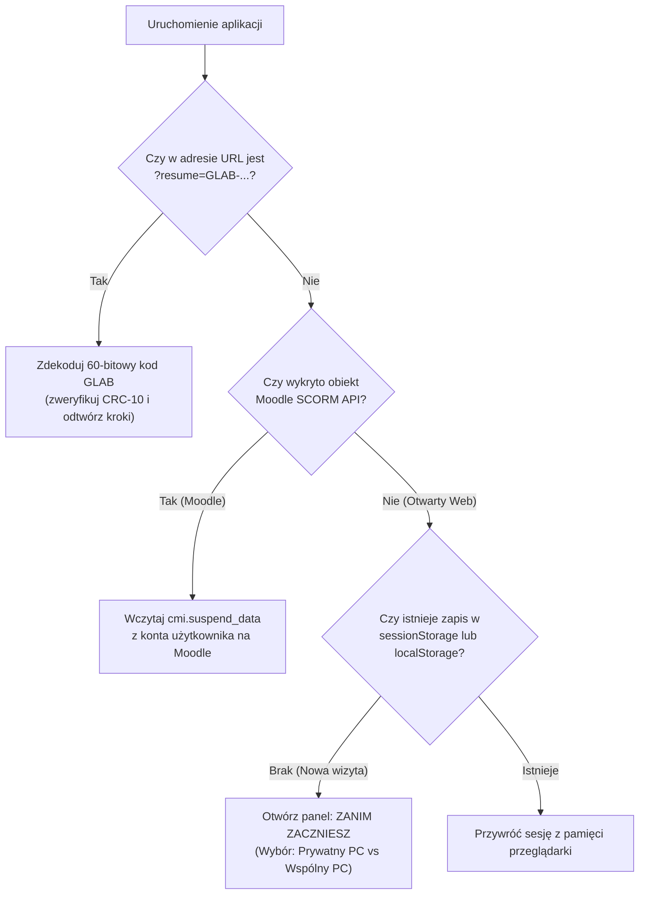

# Architektura Bezserwerowej Identyfikacji Postępów (`GLAB-...`) i Zarządzania Sesją Użytkownika

Dokument opisuje koncepcję, architekturę oraz gotową do przeniesienia implementację lekkiego systemu utrzymywania postępu użytkownika w otwartych aplikacjach edukacyjnych — działającego jednocześnie:
1. **w otwartej sieci Web na prywatnym komputerze** (bez logowania, bez kont, bez haseł/PIN-ów i bez bazy danych),
2. **w pracowni komputerowej / bibliotece na wspólnym stanowisku i wspólnym adresie IP**,
3. **przy przenoszeniu pełnego stanu roboczego w pliku `.json`**,
4. **wewnątrz platformy e-learningowej Moodle (SCORM 1.2)**.

---

## 1. Problem projektowy i założenia

W klasycznej aplikacji webowej identyfikator użytkownika (`user_id`) jest kluczem do rekordu w bazie danych na serwerze. W przypadku otwartego kursu udostępnionego publicznie podejście bazodanowe generuje cztery istotne problemy:

1. **Administracja danymi i RODO:** konieczność utrzymywania bazy danych, zabezpieczania jej przed botami/spamem oraz spełniania obowiązków informacyjnych przy zbieraniu adresów e-mail.
2. **Pułapka haseł i PIN-ów:**
   - Jeśli wymagamy hasła lub PIN-u do prostego ID, użytkownicy go zapominają (a bez zbierania adresów e-mail nie istnieje bezpieczny kanał *„Przypomnij PIN”*).
   - Jeśli nie wymagamy PIN-u, dowolna osoba może wpisać cudzy prosty identyfikator i nadpisać lub skasować czyjś postęp na serwerze.
3. **Problem pracowni komputerowej (wspólne IP + wspólne konto systemowe):**
   - Na jednym komputerze w pracowni w ciągu dnia pracuje kilka kolejnych grup.
   - Wszystkie komputery w sali wychodzą na zewnątrz z tego samego publicznego adresu IP.
   - Zapisanie postępu na stałe w przeglądarce (`localStorage`) powodowałoby, że kolejna osoba siadająca przy tym samym komputerze wchodziłaby na gotowy postęp poprzednika.

### Rozwiązanie: *Stateless Self-Contained Progress Token* (`GLAB-XXXX-XXXX-XXXX`)

Zamiast przechowywać postęp na serwerze pod identyfikatorem konta, **sam identyfikator (`GLAB-XXXX-XXXX-XXXX`) JEST binarnie zakodowanym, zabezpieczonym sumą kontrolną CRC stanem postępu użytkownika**:

- **Zero bazy danych na serwerze:** serwer hostuje wyłącznie statyczne pliki HTML/CSS/JS.
- **Brak możliwości nadpisania cudzego konta:** kod jest niemutowalnym zrzutem stanu z danej chwili.
- **Pełna przenośność:** użytkownik może skopiować 12-znakowy kod lub bezpośredni link URL (`?resume=GLAB-...`) i otworzyć go na dowolnym komputerze, w dowolnej przeglądarce, natychmiast odzyskując 100% zaliczonych kroków.

---

## 2. Budowa 60-bitowego Kodu Postępu (`GLAB-XXXX-XXXX-XXXX`)

Cały stan zaliczenia kursu pakowany jest do pojedynczej 60-bitowej liczby całkowitej (`BigInt`), która następnie jest zapisywana jako 12 znaków w alfabecie **Crockford Base32** ($12 \times 5\text{ bitów} = 60\text{ bitów}$).

### 2.1. Rozkład bitów w 60-bitowym rejestrze

```
  59          50 49    47 46        41 40                                      0
 ┌──────────────┬────────┬────────────┬─────────────────────────────────────────┐
 │ Suma CRC-10  │ Poziom │ Bieżący nr │     Mapa bitowa zaliczonych kroków      │
 │  (10 bitów)  │(3 bity)│  (6 bitów) │               (41 bitów)                │
 └──────────────┴────────┴────────────┴─────────────────────────────────────────┘
```

| Zakres bitów | Liczba bitów | Przeznaczenie | Szczegóły techniczne |
| :--- | :---: | :--- | :--- |
| **Bity `0..40`** | **41 bitów** | Mapa bitowa zaliczonych kroków (`completedSteps`) | Każdy krok kursu ma stały indeks `i` (`0..40`). Bit `1` oznacza krok zaliczony (`✓`), bit `0` — niezaliczony. |
| **Bity `41..46`** | **6 bitów** | Indeks bieżącego kroku (`0..63`) | Numer kroku (`rawCurrIdx`), na którym aktualnie znajduje się użytkownik ($2^6 = 64$ możliwe pozycje). |
| **Bity `47..49`** | **3 bity** | Aktywne poziomy kursu (`enabledTiers`) | Maska bitowa: bit 0 (`1`) = Podstawowy, bit 1 (`2`) = Rozszerzony, bit 2 (`4`) = Zaawansowany. Wartość `7` (`111₂`) oznacza wszystkie poziomy. |
| **Bity `50..59`** | **10 bitów** | Suma kontrolna **CRC-10** | Suma kontrolna liczona wielomianem `0x287` (z ziarnem początkowym `0x2a5`) po wszystkich 50 bitach danych (`0..49`). |

### 2.2. Alfabet Crockford Base32 (odporny na ludzkie błędy odczytu)

60 bitów dzielimy na 12 grup po 5 bitów (`0..31`) i mapujemy na alfabet:

```text
0123456789ABCDEFGHJKMNPQRSTVWXYZ
```

- **Wykluczone znaki mylące:** w alfabecie celowo nie występują litery `O`, `I`, `L` oraz `U`.
- **Automatyczna korekta przy wpisywaniu:** jeśli użytkownik przepisze kod ręcznie i wpisze literę `O` zamiast zera `0`, lub literę `I`/`L` zamiast jedynki `1`, dekoder automatycznie zamienia je na właściwe cyfry przed weryfikacją sumy kontrolnej CRC-10.
- **Wykrywanie literówek przez CRC-10:** 10-bitowa suma kontrolna wykrywa 100% pojedynczych przekłamań znaków oraz ~99,9% losowych kombinacji znaków. Użytkownik od razu widzi czytelny komunikat o literówce zamiast wczytania uszkodzonego stanu.

---

## 3. Cztery tryby przechowywania sesji w zależności od środowiska



### Porównanie mechanizmów

| Środowisko pracy | Mechanizm techniczny | Czas życia danych | Co jest zachowywane? |
| :--- | :--- | :--- | :--- |
| **1. Prywatny komputer (Dom / własny laptop)** | `window.localStorage` (`storageMode = "private"`) | Bezterminowo w tej przeglądarce (do ręcznego wyczyszczenia) | Pełny stan: zaliczone kroki, aktywne poziomy, bieżąca lekcja, pliki robocze VFS |
| **2. Wspólny komputer (Pracownia / biblioteka)** | `window.sessionStorage` (`storageMode = "shared"`) | **Tylko do momentu zamknięcia karty lub okna przeglądarki** (przetrwa odświeżenie `F5`) | Pełny stan na czas zajęć; po zamknięciu karty stanowisko jest w 100% czyste dla kolejnej osoby |
| **3. Kod Postępu / Link URL (`GLAB-XXXX-XXXX-XXXX`)** | 60-bitowy token Base32 + CRC-10 (`?resume=GLAB-...`) | Bezterminowo (w notatniku, telefonie, e-mailu lub zakładce przeglądarki) | Zaliczone kroki (`✓`), aktywne poziomy kursu oraz numer bieżącej lekcji |
| **4. Plik sesji `.json` (`Zapisz...` / `Wczytaj`)** | `window.showSaveFilePicker` / plik JSON na dysku lub pendrive'ie | Bezterminowo w pliku użytkownika | Pełny stan łącznie z niedokończoną edycją plików w wirtualnym dysku VFS |
| **5. Platforma Moodle (SCORM 1.2)** | `window.API` (`cmi.suspend_data` + `cmi.core.score.raw`) | Bezterminowo na serwerze Moodle (przypisane do konta na platformie) | Pełny stan (`suspend_data` do 4000 znaków) + automatyczna ocena procentowa (`0..100%`) w dzienniku ocen |

---

## 4. Komunikacja z użytkownikiem („Zanim zaczniesz”) — obowiązki i gwarancje

Kluczowym elementem systemu w wersji otwartej jest okno startowe **„Zanim zaczniesz — Jak zachować swój postęp w kursie?”** (`#userSessionModalBackdrop`), które wyświetla się automatycznie przy pierwszej wizycie (gdy brak zapisanego stanu i aplikacja nie działa wewnątrz Moodle).

Okno stawia sprawę jasno w 3 punktach:

1. **Co użytkownik MUSI ustawić:**
   - Wskazać, czy pracuje na **Prywatnym komputerze** (trwały autozapis w `localStorage`), czy na **Wspólnym / publicznym komputerze w pracowni** (tymczasowy zapis w `sessionStorage`, który kasuje `localStorage` i znika po zamknięciu karty).
   - Na wspólnym stanowisku dostępny jest również przycisk **„Wyczyść sesję z tego komputera”**, który natychmiast zeruje sesję przed odejściem od biurka.
2. **Co JEST gwarantowane:**
   - Krótki kod `GLAB-XXXX-XXXX-XXXX` (lub link `?resume=GLAB-...`) odtworzy na każdym komputerze i w każdej przeglądarce wszystkie zaliczone kroki (`✓`), wybrany poziom trudności oraz numer bieżącej lekcji.
   - Plik `.json` (*„Zapisz...” / „Wczytaj”*) zachowuje dodatkowo roboczą zawartość plików w edytorze VFS w trakcie jeszcze niezaliczonego ćwiczenia.
3. **Co NIE JEST gwarantowane (dlaczego nie ma PIN-ów ani haseł):**
   - W wersji otwartej serwis nie zbiera danych osobowych i nie prowadzi bazy kont na serwerze.
   - Jeśli użytkownik na wspólnym komputerze zamknie kartę przeglądarki (lub wyczyści dane przeglądarki na prywatnym komputerze) **bez wcześniejszego skopiowania Kodu Postępu `GLAB-...` lub zapisania pliku `.json`**, nikt — włącznie z administratorem serwera — nie ma technicznej możliwości odzyskania tego stanu.

---

## 5. Kompletna implementacja referencyjna (JavaScript)

Poniższy kod można bezpośrednio skopiować i zaadaptować w dowolnym innym kursie lub aplikacji edukacyjnej.

### 5.1. Koder i dekoder `GLAB-XXXX-XXXX-XXXX` z sumą kontrolną CRC-10

```javascript
const ProgressTokenCodec = {
  ALPHABET: "0123456789ABCDEFGHJKMNPQRSTVWXYZ",

  // 10-bitowa suma kontrolna CRC-10 (wielomian 0x287, ziarno 0x2a5) po 50 bitach danych
  computePayloadCrc10(payload50BigInt) {
    let crc = 0x2a5;
    for (let i = 0; i < 50; i++) {
      const bit = Number((payload50BigInt >> BigInt(i)) & 1n);
      const msb = (crc >> 9) & 1;
      crc = ((crc << 1) & 0x3ff) ^ ((bit ^ msb) ? 0x287 : 0);
    }
    return BigInt(crc & 0x3ff);
  },

  /**
   * Koduje stan postępu do 12-znakowego kodu GLAB-XXXX-XXXX-XXXX
   * @param {string[]} allStepIds - Stała, uporządkowana lista wszystkich ID kroków w kursie (do 41 kroków)
   * @param {Set<string>} completedSet - Zbiór zaliczonych ID kroków
   * @param {number} currentRawIdx - Indeks bieżącego kroku (0..63)
   * @param {string[]} activeTiers - Aktywne poziomy np. ["basic", "extended", "advanced"]
   */
  encode(allStepIds, completedSet, currentRawIdx, activeTiers) {
    let mask = 0n;
    for (let i = 0; i < Math.min(allStepIds.length, 41); i++) {
      if (completedSet.has(allStepIds[i])) {
        mask |= (1n << BigInt(i));
      }
    }

    const currBits = BigInt(Math.max(0, currentRawIdx) & 0x3f) << 41n;

    let tierMask = 0;
    if (activeTiers.includes("basic")) tierMask |= 1;
    if (activeTiers.includes("extended")) tierMask |= 2;
    if (activeTiers.includes("advanced")) tierMask |= 4;
    if (tierMask === 0) tierMask = 7;
    const tierBits = BigInt(tierMask & 0x7) << 47n;

    const payload50 = mask | currBits | tierBits;
    const crc10 = this.computePayloadCrc10(payload50) << 50n;
    const full60 = payload50 | crc10;

    let chars = "";
    for (let g = 11; g >= 0; g--) {
      const idx = Number((full60 >> BigInt(g * 5)) & 31n);
      chars += this.ALPHABET[idx];
    }
    return `GLAB-${chars.slice(0, 4)}-${chars.slice(4, 8)}-${chars.slice(8, 12)}`;
  },

  /**
   * Dekoduje i weryfikuje kod GLAB-XXXX-XXXX-XXXX
   * @param {string} rawCode - Wpisany przez użytkownika kod
   * @param {string[]} allStepIds - Stała, uporządkowana lista wszystkich ID kroków w kursie
   */
  decode(rawCode, allStepIds) {
    const cleaned = String(rawCode || "")
      .trim()
      .toUpperCase()
      .replace(/^GLAB-?/i, "")
      .replace(/[^0-9A-Z]/g, "")
      .replace(/O/g, "0")
      .replace(/[IL]/g, "1");

    if (cleaned.length !== 12) {
      return { error: "Kod musi mieć format GLAB-XXXX-XXXX-XXXX (12 znaków po prefiksie GLAB)." };
    }

    let full60 = 0n;
    for (let i = 0; i < 12; i++) {
      const val = this.ALPHABET.indexOf(cleaned[i]);
      if (val < 0) {
        return { error: `Nieprawidłowy znak „${cleaned[i]}” w kodzie postępu.` };
      }
      full60 = (full60 << 5n) | BigInt(val);
    }

    const payload50 = full60 & ((1n << 50n) - 1n);
    const givenCrc = (full60 >> 50n) & 0x3ffn;
    const expectedCrc = this.computePayloadCrc10(payload50);
    if (givenCrc !== expectedCrc) {
      return { error: "Suma kontrolna kodu jest nieprawidłowa (literówka w kodzie GLAB-...)." };
    }

    const completedStepIds = [];
    for (let i = 0; i < Math.min(allStepIds.length, 41); i++) {
      if (((payload50 >> BigInt(i)) & 1n) === 1n) {
        completedStepIds.push(allStepIds[i]);
      }
    }

    const currentRawIdx = Number((payload50 >> 41n) & 0x3fn);
    const tierMask = Number((payload50 >> 47n) & 0x7n);
    const enabledTiers = [];
    if (tierMask & 1) enabledTiers.push("basic");
    if (tierMask & 2) enabledTiers.push("extended");
    if (tierMask & 4) enabledTiers.push("advanced");

    return {
      completedStepIds,
      currentRawIdx: Math.min(currentRawIdx, Math.max(0, allStepIds.length - 1)),
      enabledTiers: enabledTiers.length > 0 ? enabledTiers : ["basic", "extended", "advanced"]
    };
  }
};
```

### 5.2. Przełącznik pamięci `Prywatny PC (localStorage)` vs `Wspólny PC (sessionStorage)`

```javascript
const SessionStorageAdapter = {
  STORAGE_KEY: "course_engine_state_v1",
  MODE_KEY: "course_storage_mode",
  storageMode: "private", // "private" | "shared"

  setStorageMode(mode) {
    this.storageMode = (mode === "shared") ? "shared" : "private";
    sessionStorage.setItem(this.MODE_KEY, this.storageMode);
    if (this.storageMode === "shared") {
      // Natychmiast usuń trwały ślad z localStorage na wspólnym komputerze
      localStorage.removeItem(this.STORAGE_KEY);
    }
  },

  save(stateObj) {
    const rawJson = JSON.stringify({ ...stateObj, storageMode: this.storageMode });
    if (this.storageMode === "shared") {
      sessionStorage.setItem(this.STORAGE_KEY, rawJson);
      localStorage.removeItem(this.STORAGE_KEY);
    } else {
      localStorage.setItem(this.STORAGE_KEY, rawJson);
    }
  },

  load() {
    const sess = sessionStorage.getItem(this.STORAGE_KEY);
    if (sess) {
      const parsed = JSON.parse(sess);
      if (parsed.storageMode === "shared") this.storageMode = "shared";
      return parsed;
    }
    const local = localStorage.getItem(this.STORAGE_KEY);
    return local ? JSON.parse(local) : null;
  },

  clearAll() {
    localStorage.removeItem(this.STORAGE_KEY);
    sessionStorage.removeItem(this.STORAGE_KEY);
  }
};
```

---

## 6. Jak skalować ten mechanizm w większych kursach?

- **Do 41 kroków:** `GLAB-XXXX-XXXX-XXXX` (12 znaków Base32 = 60 bitów: 41 bitów kroków + 6 bitów indeksu + 3 bity poziomów + 10 bitów CRC-10).
- **Do 61 kroków:** `GLAB-XXXX-XXXX-XXXX-XXXX` (16 znaków Base32 = 80 bitów: 61 bitów kroków + 6 bitów indeksu + 3 bity poziomów + 10 bitów CRC-10).
- **Powyżej 65 kroków (np. 100–250 zadań):** zamiast stałego `BigInt` pakujemy tablicę bajtów (`Uint8Array`) zawierającą bitmaskę kroków + 2 bajty sumy kontrolnej `CRC-16` i kodujemy ją w `Base64URL` jako parametr linku `?resume=...`.
